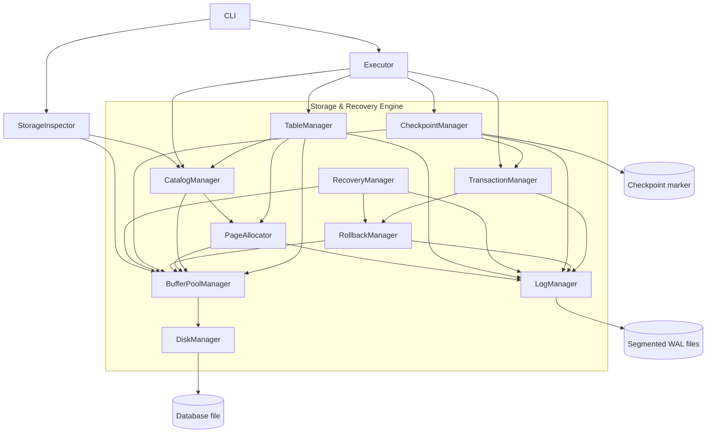

# LettyDB

LettyDB is a disk-based relational database written from scratch in C++17 to explore how databases work internally. It implements its own SQL frontend, page storage, buffer pool, write-ahead log (WAL), ARIES crash recovery, page allocator, catalog, and query executor. Only external dependencies are added to support the CLI, logging, formatting, and tests. The core functionality of this database is implemented without any external libraries.

**Current milestone: [`v0.6-wal`](https://github.com/amitvc/lettydb/tree/v0.6-wal).** You can create tables, insert and query rows, delete data, compact tables, inspect the underlying storage from the CLI, and recover automatically from process crashes with full WAL durability and transactional rollback.

## Terminal demo

[](https://asciinema.org/a/Tx3rZ8HmkLZCBHQ2)

Watch the 35-second walkthrough: create a table, insert and filter rows, delete, compact, inspect storage, and reopen the database.

You can also download the [recording](demo.cast) and play it locally:

```sh
asciinema play demo.cast
```

## What has been built

| Component | Current capabilities |
| --- | --- |
| SQL frontend | Handwritten lexer and recursive descent parser producing an abstract syntax tree (AST). |
| Disk storage | 4 KiB pages with a uniform 20-byte page header (LSN, prev/next links, table ID, page type) and slotted pages for tuples. |
| Buffer pool | Steal/no-force page caching, pin/unpin tracking, dirty-page flushing, LRU eviction, and cache statistics. |
| Write-ahead log (WAL) | Segmented WAL files, buffered log flushing, CRC32-checksummed records, and fuzzy checkpointing. |
| Transactions & recovery | Per-statement transactions, rollback via Compensation Log Records (CLRs), and ARIES crash recovery (**Analysis → Redo → Undo**). |
| Page allocation | `PageAllocator` manages single-page allocation, an on-disk LIFO freelist rooted at Page 0, and doubly-linked table page chains. |
| Catalog | Persistent table definitions and schemas, loaded when reopening a database. |
| Query execution | `CREATE TABLE`, multi-row `INSERT`, single-table `SELECT` with column projection and `WHERE`, and `DELETE` with optional filtering. |
| Space reclamation | `COMPACT TABLE` repacks live tuples and releases empty pages back to the freelist for reuse. |
| CLI and inspection | Interactive SQL, command history, keyword completion, formatted results, and storage inspection commands. |

### Components

`DatabaseEngine` wires the components together and runs ARIES crash recovery on startup before initializing the catalog. This diagram shows their main relationships; all page access goes through `BufferPoolManager`, and all page mutations are logged through `LogManager`.



The inspector reads page headers, Page 0 metadata, freelist chains, and table page chains through `BufferPoolManager` and `CatalogManager`.

Durability and crash recovery follow the **ARIES** protocol over a **steal/no-force** buffer pool:
- **Write-ahead rule (Steal / No-Force):** Dirty pages may be evicted before their transaction commits once the WAL is flushed through the page's `page_lsn`; transaction commit only flushes the WAL rather than forcing data pages to disk.
- **Fuzzy checkpointing:** Periodic checkpoints snapshot the Dirty Page Table and Active Transaction Table to the WAL and record the checkpoint LSN in `<db>.checkpoint` to bound recovery time without blocking active writers.
- **ARIES recovery & CLR rollback:** On startup, `RecoveryManager` runs **Analysis**, **Redo** (repeating history from the minimum recovery LSN), and **Undo** (rolling back uncommitted transactions in reverse LSN order while writing redo-only Compensation Log Records).

## Milestone tags

Each tag marks a working stage of the database's development.

| Tag | Milestone |
| --- | --- |
| [`v0.1-sql-frontend`](https://github.com/amitvc/lettydb/tree/v0.1-sql-frontend) | SQL lexer, recursive descent parser, and AST generation. |
| [`v0.2-storage-engine`](https://github.com/amitvc/lettydb/tree/v0.2-storage-engine) | Storage layer: buffer pool, extent allocation, IAM, and table management. |
| [`v0.3-query-execution`](https://github.com/amitvc/lettydb/tree/v0.3-query-execution) | Scanner-based table reads, `SELECT` projection, and `WHERE` filtering. |
| [`v0.4-delete-query`](https://github.com/amitvc/lettydb/tree/v0.4-delete-query) | `DELETE` with `WHERE`, plus `IS NULL` and `IS NOT NULL` predicates. |
| [`v0.5-compact-table`](https://github.com/amitvc/lettydb/tree/v0.5-compact-table) | Table compaction with tuple migration and extent reclamation through GAM. |
| [`v0.6-wal`](https://github.com/amitvc/lettydb/tree/v0.6-wal) | Segmented write-ahead logging (WAL), transactional rollback with CLRs, fuzzy checkpointing, and ARIES crash recovery. |

To explore a specific milestone, check out its tag before configuring and building:

```sh
git checkout v0.6-wal
```

The usage examples below target the current milestone. Earlier tags have fewer capabilities.

## Build

Prerequisites:

- A C++17 compiler and a POSIX environment, such as macOS or Linux.
- CMake 3.22 or newer, Make, and Git.
- Network access on the first configuration to download dependencies.
- Optional: Doxygen and Graphviz for API documentation and diagrams.

CMake downloads spdlog, replxx, nlohmann/json, tabulate, and GoogleTest automatically.

```sh
git clone https://github.com/amitvc/lettydb.git
cd lettydb
cmake --preset debug
cmake --build --preset debug
```

For a release build, use `cmake --preset release` followed by `cmake --build --preset release`. Its executable is placed in `cmake-build-release/`.

## Use LettyDB

Start the CLI with a new or existing database file:

```sh
./cmake-build-debug/lettydb_cli demo.db
```

If no path is supplied, the CLI uses `letty.db` in the current directory. Reopen the same path to access saved tables and rows after a normal shutdown. Command history is stored in `<database-path>.history`, and diagnostic logs are written to `letty.log` in the current directory.

Enter **one complete SQL statement per line**. The CLI does not accumulate multiline statements. Use `help` or `\h` for help, and `exit`, `quit`, or `\q` to close it.

### Try a complete session

Run these statements in a fresh database:

```sql
CREATE TABLE users (id INT NOT NULL, name VARCHAR(50) NOT NULL, age INT, active BOOL);
INSERT INTO users VALUES (1, 'Ada', 36, true), (2, 'Grace', 45, true), (3, 'Linus', NULL, false);
SELECT * FROM users;
SELECT name, age FROM users WHERE age >= 40 AND active = true;
SELECT name FROM users WHERE age IS NULL;
DELETE FROM users WHERE active = false;
COMPACT TABLE users;
SELECT id, name FROM users;
```

The filtered queries return Grace and Linus, respectively. After deletion and compaction, Ada and Grace remain. Compaction reports tuples migrated and pages freed; a small table may have no empty pages to release. Freed pages are pushed onto the freelist for reuse within the database, rather than shrinking the database file.

Exit and reopen `demo.db`, then run `SELECT * FROM users;` to see the retained rows.

### Inspect storage

These are CLI commands, so enter them **without a trailing semicolon**:

```text
INSPECT SUMMARY
INSPECT FREELIST
INSPECT TABLE users
```

Use a data page ID from `INSPECT TABLE users` to inspect its contents. For example, if the table starts at page `3`, run `INSPECT PAGE 3 users`.

| Command | Shows |
| --- | --- |
| `INSPECT SUMMARY` | Page counts (total, used, free), table count, freelist head, and buffer-pool statistics. |
| `INSPECT FREELIST` | Free-page LIFO chain starting from Page 0. |
| `INSPECT TABLE users` | The table's doubly-linked page chain, slot counts, and free space. |
| `INSPECT PAGE <page_id>` | Page header, details, and a hex dump. |
| `INSPECT PAGE <page_id> users` | Page details with tuples decoded using the table's schema; choose a data page belonging to that table. |

### IDE consoles and redirected input

Use `--simple` to disable the interactive line editor:

```sh
./cmake-build-debug/lettydb_cli demo.db --simple
```

You can also redirect a file containing one statement per line:

```sh
./cmake-build-debug/lettydb_cli demo.db --simple < queries.sql
```

Redirected input still produces CLI banners, prompts, and formatted results.

## SQL support and current limits

- `INSERT` accepts multiple rows and explicit column lists. Omitted nullable columns become `NULL`; `NOT NULL` columns require values.
- `SELECT` supports `*` or named columns from a single table. `WHERE` supports `=`, `!=`, `<`, `<=`, `>`, `>=`, `AND`, `OR`, parentheses, `IS NULL`, and `IS NOT NULL`.
- `DELETE FROM table_name` deletes every row; add `WHERE` to delete matching rows only.
- Mutating statements (`CREATE TABLE`, `INSERT`, `DELETE`, `COMPACT TABLE`) run as atomic, WAL-backed transactions with automatic rollback on failure and ARIES crash recovery on startup.
- Queries use table scans. Indexes and a query optimizer are not implemented.
- Parser support is broader than execution support. `UPDATE`, `DROP TABLE`, and `CREATE INDEX` are not executable. Joins, grouping, aggregates, and primary-key enforcement are not implemented, even where syntax is recognized.

## What is next

Longer-term goals include:

- Multi-statement explicit SQL transactions (`BEGIN`, `COMMIT`, `ROLLBACK`) and concurrency control / isolation levels.
- B+ tree indexing and query optimization.
- Broader SQL execution support (`UPDATE`, `DROP TABLE`, joins, and aggregates).
- A TCP client/server interface for remote connections.

## Tests and API documentation

Run the test suite after building:

```sh
ctest --preset debug --output-on-failure
```

The tests cover the SQL frontend and executor, catalog, storage pages, tuple serialization, buffer pool and LRU replacement, single-page allocation and freelist management, compaction, segmented WAL management, transaction rollback with CLRs, fuzzy checkpointing, and ARIES crash recovery. The suite also includes buffer-pool benchmarks and multi-threaded stress tests—verified up to 100 million rows (2.87 GB across 200 tables) under 10 concurrent writer threads and 3 concurrent reader threads (~83k rows/s with 26k+ concurrent scans and full SQL parsing and WAL durability).

With Doxygen and Graphviz installed before configuration, generate API documentation with:

```sh
cmake --build --preset docs
```

Open `cmake-build-debug/docs/html/index.html` to browse it.
